# MultiLingual POS

**Il gestionale che parla la tua lingua.** An offline-first point of sale and light inventory system for
foreign-owned shops in Italy (minimarkets, butchers, fast food): Italian, English, Arabic (right-to-left),
Bengali and Simplified Chinese, with credit sales, weight-based products and a picture-first till.

It is a *gestionale*, **not a fiscal register** (no registratore telematico). Receipts are internal and
say `DOCUMENTO NON FISCALE`.

> All screenshots below use the built-in demo shop ("Minimarket Dhaka Roma"): 14 products with
> illustrations, a week of sales, four customers, suppliers, orders and waste. Load the same catalogue yourself
> from **Prodotti → Carica prodotti demo**.

---

## Contents

1. [What it does](#what-it-does) (with screenshots)
2. [How it works](#how-it-works)
3. [Getting started](#getting-started)
4. [Project layout](#project-layout)
5. [Data model](#data-model)
6. [Translations](#translations)
7. [Testing and status](#testing-and-status)
8. [Known limitations](#known-limitations)

---

## What it does

### Sign in with a PIN, switch user in one tap

The owner signs in once with an email and password. After that, staff switch with a 4–6 digit PIN, so nobody
types a password during a busy hour. The PIN is checked on the device, so it works offline. Each person's
**language follows them**: a Bengali-speaking cashier gets Bengali, the owner gets Italian, on every till.

| Role | Can do |
|---|---|
| **Owner** | Everything: products, customers, inventory, reports, staff, settings. |
| **Cashier** | The sales screen and the language setting only. No costs, margins or debts are visible. |

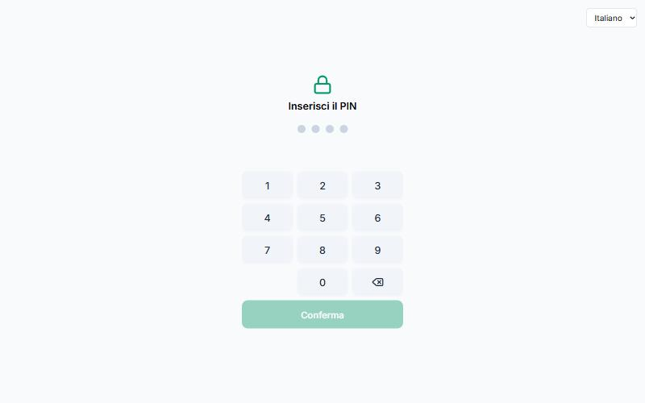

### Sales screen (Cassa)

A touch-first grid of product pictures (every control is at least 44 px). Search by name in **any** of the five
languages or by barcode. Scan with a **USB or Bluetooth scanner** (it types the code like a keyboard) or the
**camera** (native `BarcodeDetector` where the browser has it, ZXing everywhere else).
Category chips are colour-coded. An amber badge on a tile means the product is low on stock.

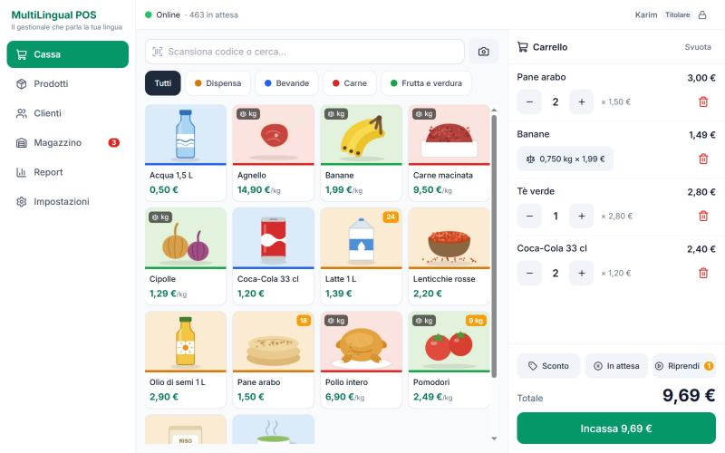

**Weighed products** (meat, fruit and vegetables) open a kg keypad with 250 g / 500 g / 1 kg / 2 kg shortcuts and
show the price as you type.

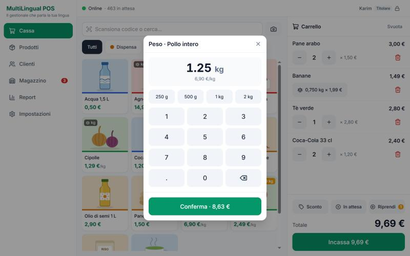

**Discounts**: a percentage or a fixed amount on the whole basket, capped at the basket value. A percentage
follows the basket as items are added or removed. The receipt shows subtotal, discount and total, with the IVA
split adjusted to what was really charged.

<table><tr>
<td>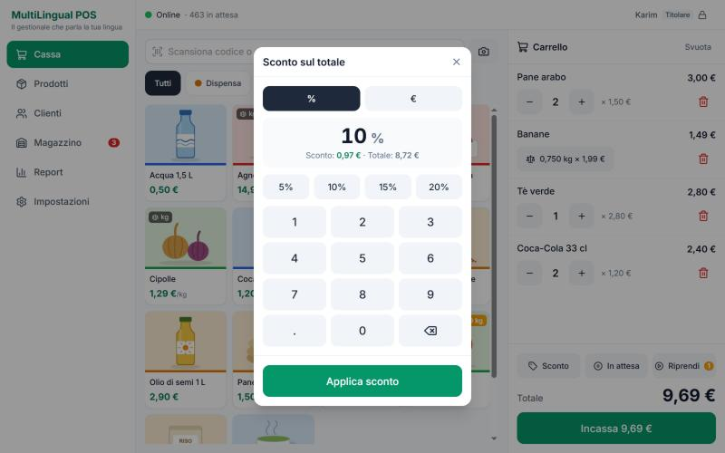</td>
<td>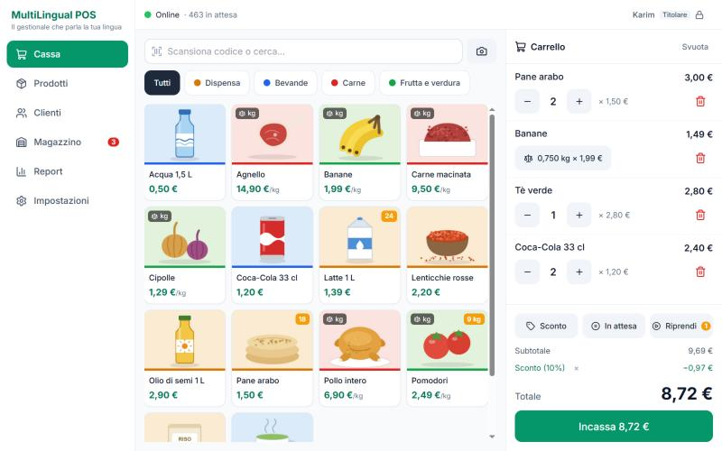</td>
</tr></table>

**Payment by cash, card or credit** (*vendita a credito*). For cash, quick note buttons and change calculation. For
credit, pick a customer (or add one on the spot), optionally take a deposit now, and the rest goes on their debt.

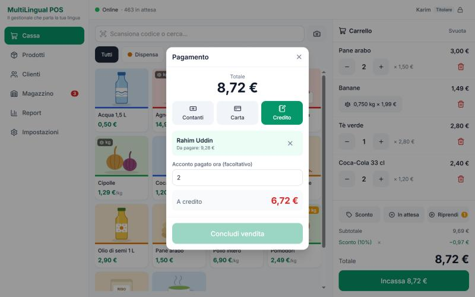

**Receipt**: printable on an 80 mm roll or saved as PDF from the print dialog. It shows the IVA split by rate
(4%, 10%, 22%), the customer on credit sales, and is clearly marked as non-fiscal.

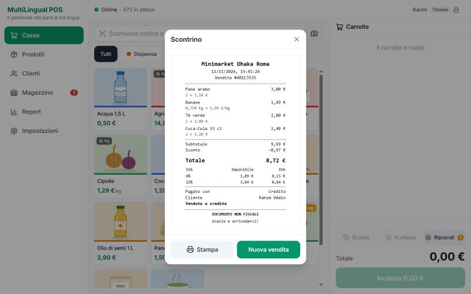

**Hold and resume**: park a basket and serve the next customer. Parked sales survive a reload and never touch
stock. When resumed, prices are refreshed and products deleted in the meantime are dropped, with a notice.
Resuming while another basket is open parks that one instead of losing it.

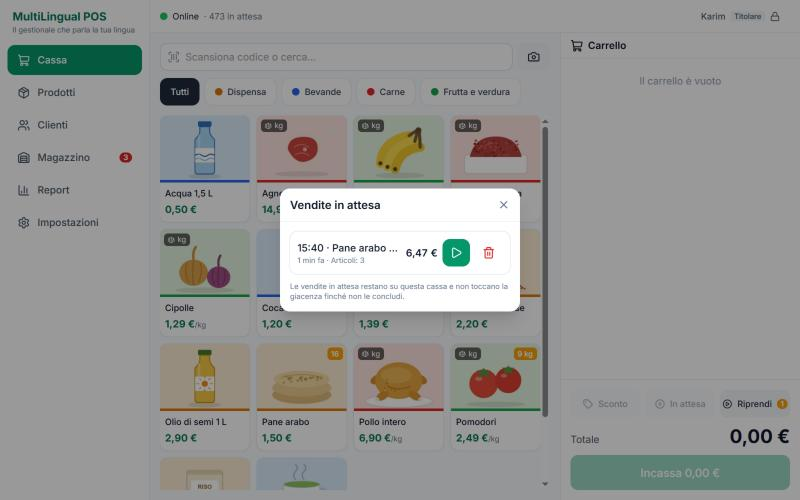

### Products (Prodotti)

Create and edit products with a **photo** (camera or file; resized and stored on the device), a **name in each of the
five languages**, a barcode (typed or scanned), price per piece **or per kg**, cost price, stock, reorder level,
category and IVA rate (4 / 10 / 22 %). Categories have a colour. Products can be deactivated or deleted.

<table><tr>
<td>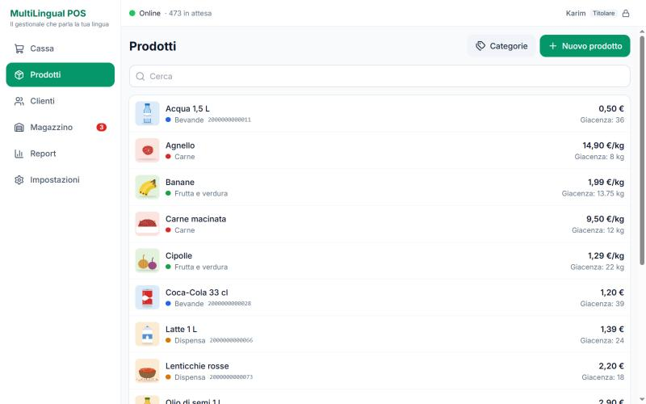</td>
<td>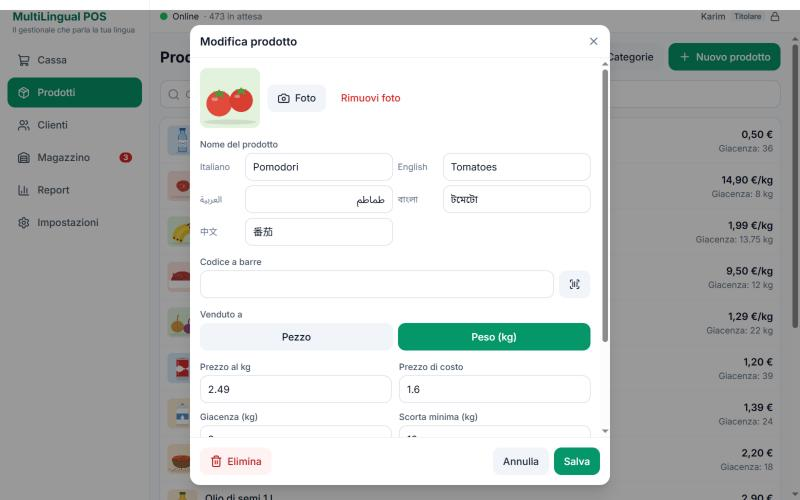</td>
</tr></table>

### Customers and credit (Clienti)

A customer list with phone numbers and notes, and the total owed to you. Each customer has a **ledger**: every credit sale
and payment with a running balance, a receipt for each sale, and **partial payments** (capped at what is owed;
a mistaken payment can be deleted). The **WhatsApp reminder** opens a `wa.me` link with the message written in the
**customer's own language** (editable before sending).

> A customer's debt is *calculated* (credit sales minus payments), never stored as a number, so two tills recording
> payments for the same customer can never overwrite each other.

<table><tr>
<td>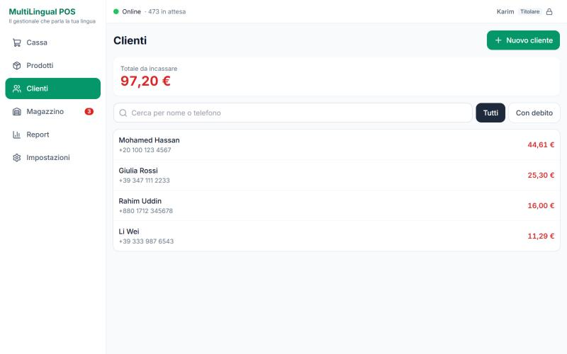</td>
<td>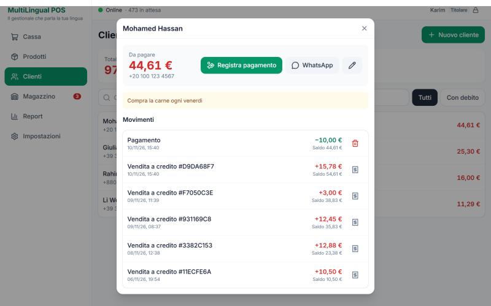</td>
</tr></table>

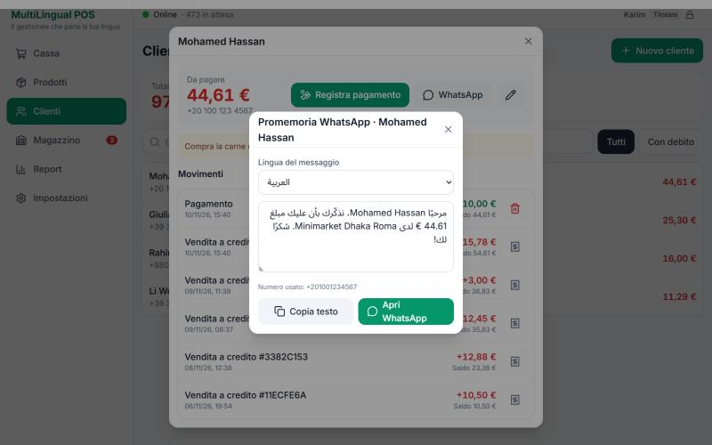

### Inventory (Magazzino)

- **Stock levels with alerts.** Set a reorder level per product. At or below it you get an amber tile badge on the
  till, a red count on the menu, and a *Low stock* list with one tap to draft an order for those products.
- **Suppliers.** Name, phone, email, notes.
- **Purchase orders.** Draft → ordered → received (or cancelled). Receiving takes the quantity that really arrived,
  raises stock, and can update the product's cost price. Receiving the same delivery on two tills counts once.
- **Waste and loss.** Record unsold or lost stock with a reason (expired, spoiled, damaged, theft, other) and a note.
  Losses over 30 days are valued at the current cost price.

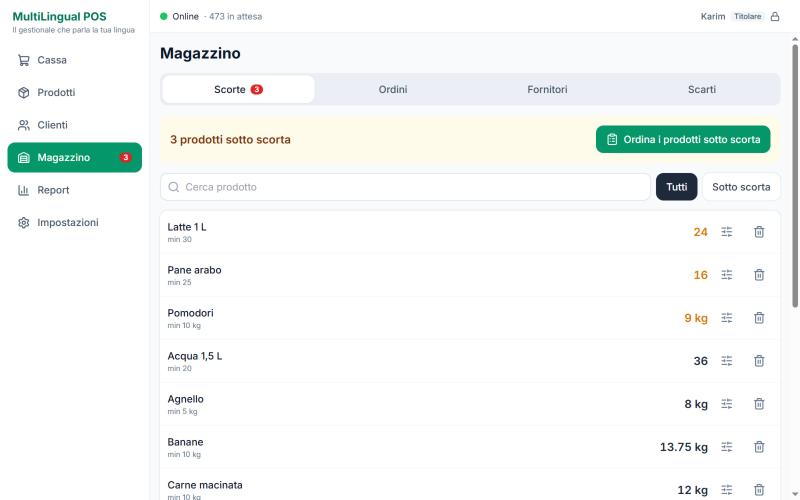

<table><tr>
<td>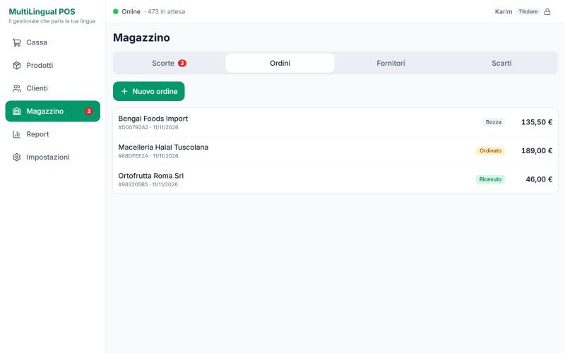</td>
<td>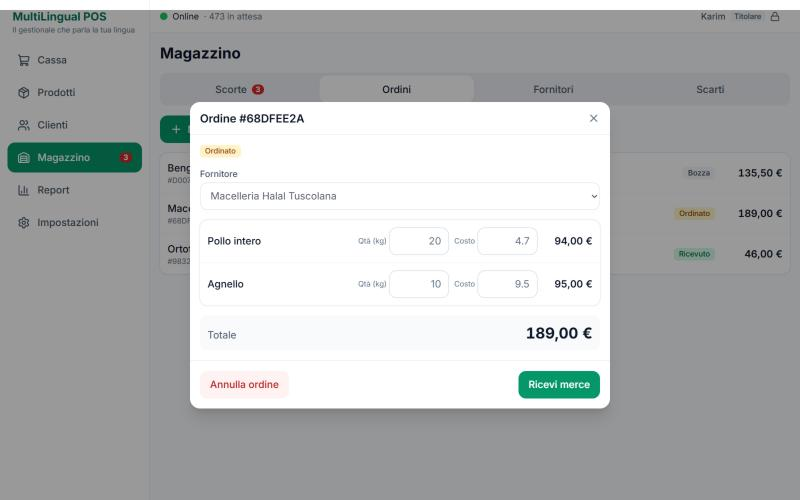</td>
</tr><tr>
<td>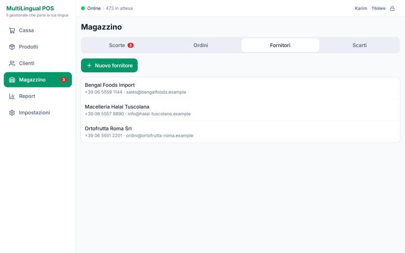</td>
<td>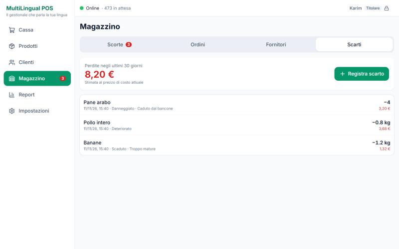</td>
</tr></table>

### Reports (Report)

- **Chiusura di giornata (end-of-day report).** For any day: total sold, sale count, average sale, split by cash /
  card / credit, customer payments received, the **cash expected in the drawer** (with a field to type what you counted
  and the difference), IVA by rate, and sales per operator. Prints on an 80 mm slip (non-fiscal).
- **Products.** Top sellers and **profit margin** for today, 7 days, this month, 30 days or custom dates.
- **Export.** CSV of sales lines, per-product summary or per-day summary, in Italian-Excel format (`;` and decimal
  comma) or international format. UTF-8, so Arabic, Bengali and Chinese names survive.

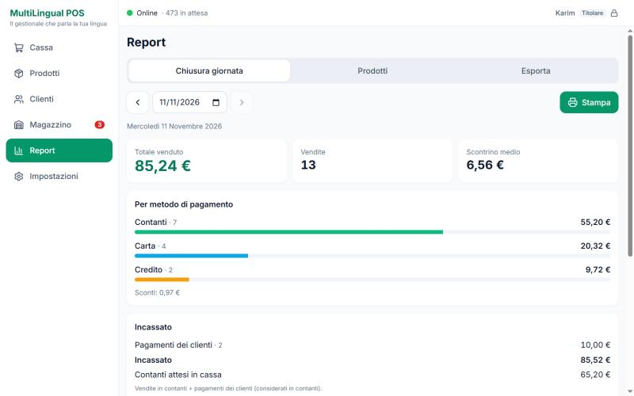

<table><tr>
<td>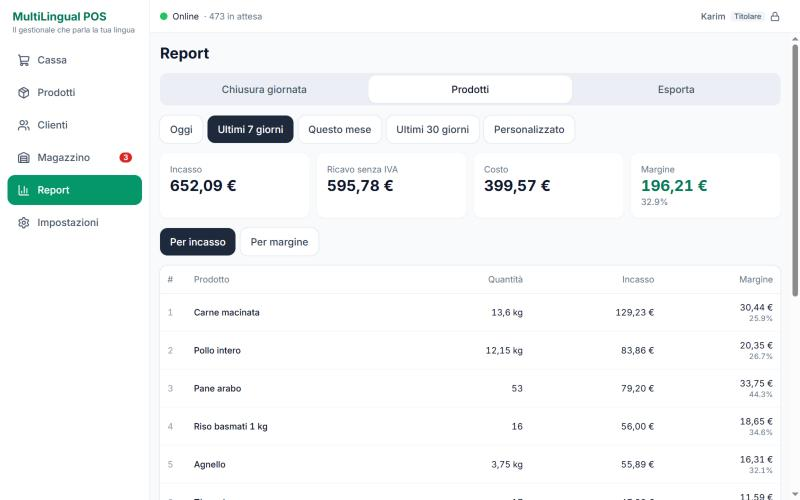</td>
<td>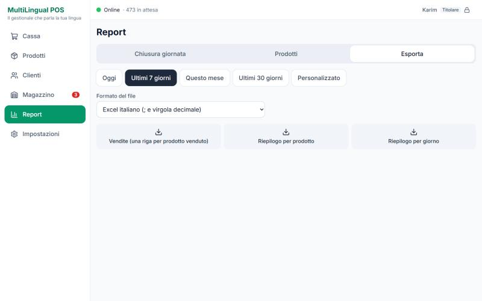</td>
</tr></table>

Margins use the **cost and IVA rate stored on each sale line at the moment of sale**, so a later price change or a
delivery that updates a cost never rewrites past results. Margin is revenue *without* IVA minus cost; cost prices are
taken as entered without IVA.

### Five languages, including right-to-left

Italian (default), English, **Arabic (the whole layout mirrors)**, Bengali and Simplified Chinese. All text is in
JSON files. The fonts ship with the app (no Google Fonts), so every script renders offline. Product names show in the
language of the screen, falling back to Italian.

<table><tr>
<td>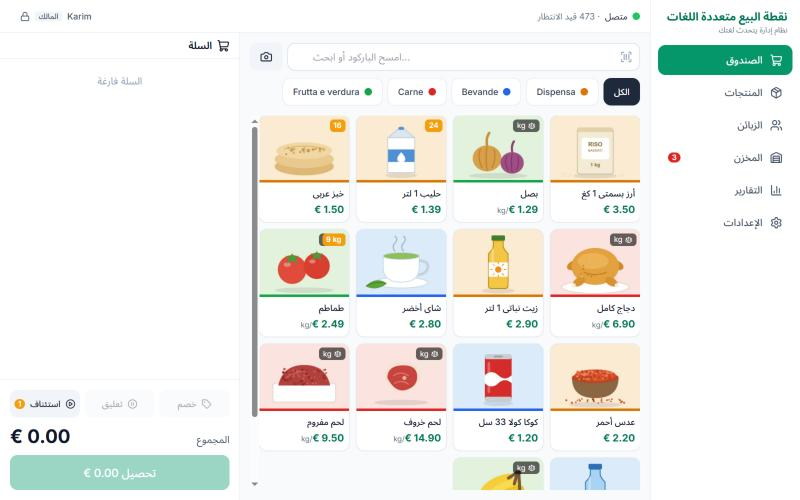</td>
<td>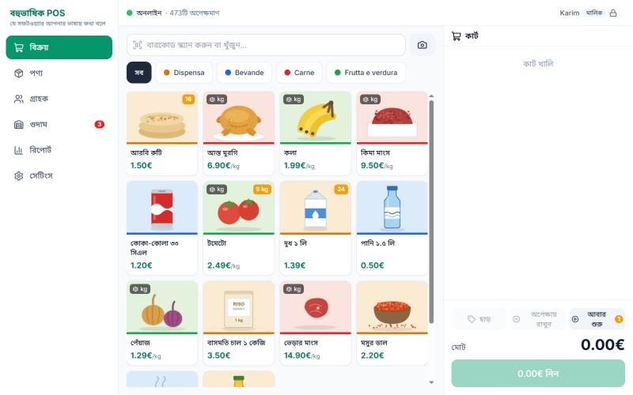</td>
</tr><tr>
<td>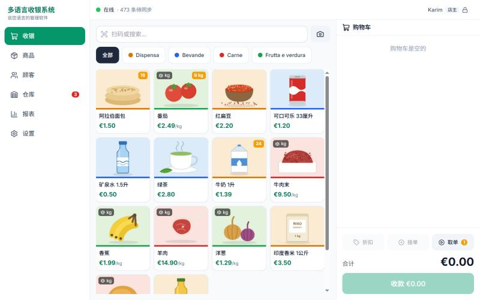</td>
<td>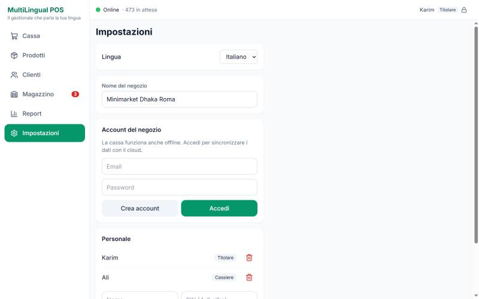</td>
</tr></table>

### Works with no internet

The app is a PWA: it installs to the home screen and opens with no connection. Every sale is written to the device first. The dot at
the top is **green** online and **red** offline, with a count of changes waiting to be sent. Everything keeps working;
the queue empties by itself when the connection returns.

<table><tr>
<td>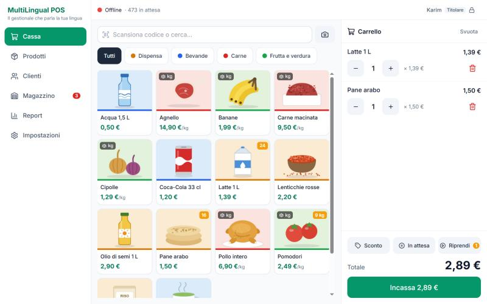</td>
<td>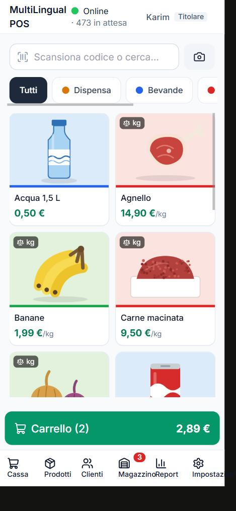</td>
</tr></table>

---

## How it works

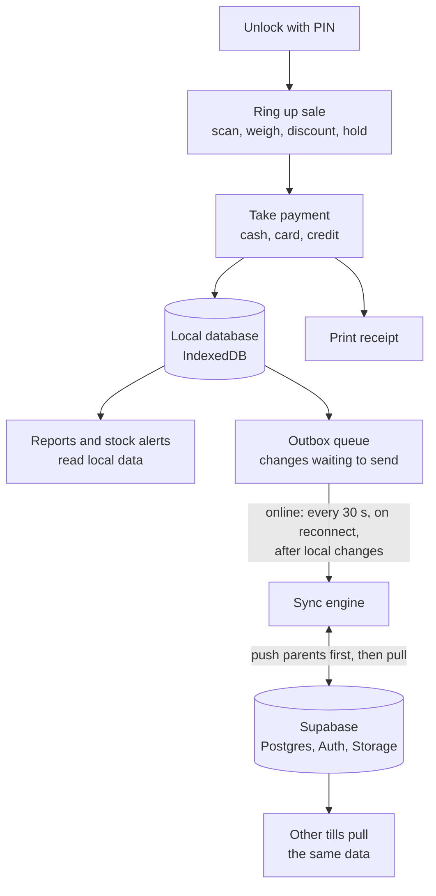

**Offline first.** Every write goes to IndexedDB (Dexie) first, plus one entry in an outbox. The sync engine
sends the outbox to Supabase when online, then pulls what other tills changed.

**Newest edit wins** per row (`updated_at`), enforced on both the till and the server, so a till that reconnects late
cannot overwrite a newer edit. Pulls use a server-assigned timestamp (`synced_at`) so a late arrival is never missed.

**Stock is a ledger, not a number.** Sales, deliveries, waste and corrections are append-only `stock_movements`.
The server sums them into `product_stock`, and a till shows *server stock + its own unsent movements*.
Two tills selling the same item offline therefore never lose a sale. The same idea applies to customer debt.

**Failures are contained.** A row the server refuses is retried up to 5 times, then flagged to the owner (with a Retry
button) without blocking the rest. Outages and expired sessions never count against a row.

**Security.** Row Level Security keeps each shop to its own rows. Photos live in a private Storage bucket, one
folder per shop. PINs are stored as PBKDF2 hashes. A PIN decides *who is at the till*, it does not protect the data on a stolen device.

---

## Getting started

Requires Node 20+ (developed on 24).

```bash
cd ERP/pos
npm install
npm run dev          # http://localhost:5173
```

It runs fully **without any backend** (local-only mode: no sign-in, no sync). To try it, open **Prodotti → Carica
prodotti demo**, then **Cassa**.

### With Supabase (sign-in and sync)

1. Create a Supabase project, or run one locally (needs Docker): `npx supabase start`.
2. Copy `.env.example` to `.env.local` and fill in the project URL and anon key:
   ```
   VITE_SUPABASE_URL=...
   VITE_SUPABASE_ANON_KEY=...
   ```
3. Apply the migrations **in order** (`supabase/migrations/0001` … `0009`):
   - local: `npx supabase migration up --local`
   - hosted: `npx supabase link --project-ref <ref>` then `npx supabase db push`
4. Restart `npm run dev`, then open **Impostazioni → Account del negozio** and create the shop account.
   Locally, email confirmation is off (`supabase/config.toml`). **On a hosted project, configure Auth emails first.**
5. Sign in on a second device or browser profile with the same account to see the data sync.

Camera scanning and PWA install need **HTTPS** (or `localhost`).

### Scripts

| Command | What it does |
|---|---|
| `npm run dev` | Dev server |
| `npm run build` | Type-check and production build (with the service worker) |
| `npm run preview` | Serve the production build |
| `npm run typecheck` | TypeScript only |
| `npm run i18n:check` | Every language has every string, `{{placeholders}}` match |
| `npm run i18n:export` / `i18n:import` | Spreadsheet round trip for native-speaker review |

---

## Project layout

```
src/
  app/          router
  auth/         linking a till's offline data to the shop account
  components/   layout (sidebar, indicator), modal, keypad, barcode scanner
  db/           Dexie schema (db/index.ts) and write helpers with outbox (db/repo.ts)
  features/     sales, products, customers, inventory, reports, receipt, staff, settings
  hooks/        live queries, scanner wedge, per-user language
  i18n/         i18n setup and locales/{it,en,ar,bn,zh}.json
  lib/          money, phone/WhatsApp, PIN hashing, images, scanning, Supabase client
  stores/       Zustand: cart, session, auth, connectivity
  sync/         push, pull, stock recompute, photos, error classes, engine
  types/        entity types
supabase/migrations/   0001 … 0009
scripts/i18n.mjs       translation tools
docs/screenshots/      the images in this file
DEVICE_TEST.md         checklist for testing on real hardware
```

---

## Data model

Tables (every row has a client-generated UUID, `user_id` = the shop, `updated_at`, soft-delete `deleted`):
`categories`, `products`, `customers`, `staff` (name, role, PIN hash, language), `sales`, `sale_items`
(with the cost and IVA rate at sale time), `debt_payments`, `suppliers`, `purchase_orders`,
`purchase_order_items`, `stock_movements` (append-only), plus server-only `product_stock` and the
`customer_balances` view.

| Migration | Adds |
|---|---|
| `0001`–`0002` | Base schema, Row Level Security, receipt line order |
| `0003` | Stock ledger, server-side stock, tenant isolation on movements |
| `0004` | `synced_at` and newest-edit-wins on the server |
| `0005` | Private photo bucket |
| `0006` | Credit: debt derived from sales and payments, `customer_balances` |
| `0007` | Reorder levels, waste reasons, purchase-order checks |
| `0008` | Cost and IVA rate stored per sale line |
| `0009` | Discount checks, staff language |

---

## Translations

All five languages live in `src/i18n/locales/`. The Arabic, Bengali and Chinese strings were **machine-written
and have not been reviewed by native speakers.**

```bash
npm run i18n:check                       # catches missing strings and broken {{placeholders}}
npm run i18n:export                      # writes i18n-review/translations.csv (opens in Excel)
npm run i18n:import -- file.csv --dry    # preview a reviewer's corrections, then run without --dry
```

---

## Testing and status

All MVP features in the spec are built. Testing so far was done on **two simulated tills** against a local Supabase:
offline sales on both tills with conflicting edits, outages and expired sessions, double-received deliveries,
discount and language sync, report figures checked against hand calculations, and the database rules in a Postgres
test suite. There is **no automated test suite in this repository yet**; those checks were scripts run outside it.

Not yet done: a real-device test (tablet, scanner, printer, camera), a hosted Supabase project, a native-speaker
translation review and the pilot in two shops. Use [`DEVICE_TEST.md`](DEVICE_TEST.md) for the hardware checks.

---

## Known limitations

- **No direct thermal-printer support.** Printing goes through the browser's print dialog; a thermal printer installed
  as a normal printer works.
- **Sync is by polling** (every 30 s, on reconnect and after changes), not Supabase Realtime.
- **Camera scanning** was tested only on still images, not on a live camera.
- **Held sales stay on the till where they were parked** and do not sync.
- **Category names are a single text field**, so they are not translated per language (product names are).
- **Any cashier can apply any discount.** There is no limit setting yet.
- **Customer payments are counted as cash** in the end-of-day report; the app does not record how they were paid.
- **The report day follows the device clock** (the shop's local time).
- **Phone layout:** on 375 px-wide screens the bottom menu labels are tight and the page is about 20 px too wide.
- **Plural wording:** a few messages read "1 righe" instead of "1 riga".
- **Sign-up emails** (confirmation, password reset) are not configured.
- Data lives in the browser: a different browser or device starts empty until you sign in and sync.
